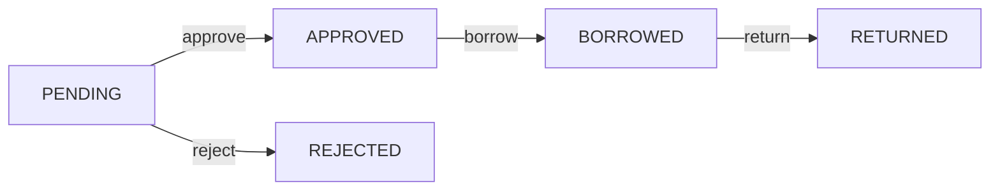

# SIPUS - Portal Petugas (Frontend)

Aplikasi web untuk petugas pada **Sistem Informasi Perpustakaan Sekolah (SIPUS)**. Petugas dapat mengelola koleksi buku, memverifikasi pengajuan peminjaman, mencatat peminjaman langsung dan pengembalian, serta melihat riwayat transaksi.

Repository ini hanya berisi **frontend petugas**.

## Fitur

- **Login dan logout petugas** memakai nomor induk (ID petugas) dan password. Halaman petugas terproteksi, hanya akun dengan role `staff` yang bisa masuk.
- **Dashboard**: 4 kartu statistik, daftar pengajuan peminjaman terbaru, dan peringatan stok buku rendah.
- **Kelola Data Buku**: lihat, tambah, ubah, dan hapus buku (hapus bersifat soft delete di backend).
- **Permintaan Peminjaman**: setujui atau tolak pengajuan siswa. Penolakan bisa disertai alasan (opsional).
- **Peminjaman Langsung**: catat peminjaman di tempat untuk siswa, guru, staf, atau tamu. Satu transaksi bisa berisi beberapa buku.
- **Pengembalian Buku**: catat pengembalian, transaksi yang terlambat ditampilkan paling atas.
- **Riwayat Transaksi**: seluruh transaksi dengan filter status.
- **Navigasi sidebar** yang bisa dilipat (expand/collapse) dan otomatis menjadi blok menu di atas pada layar kecil.

## Tech Stack

| Kategori | Teknologi |
|---|---|
| Library UI | React 19 (JavaScript) |
| Build tool dan dev server | Vite |
| Styling | Tailwind CSS (design token warna di `src/index.css`) |
| Routing | React Router (`react-router-dom`) |
| Komunikasi API | Axios |
| Ikon | lucide-react |
| Linter | ESLint |

Manajemen state memakai hook bawaan React dan Context API (untuk data login), dan satu custom hook (usePaginatedData) untuk data berhalaman. Tidak ada library state management tambahan.

## Prasyarat

- [Node.js](https://nodejs.org) versi LTS (dikembangkan dengan Node.js v24) beserta npm
- [Git](https://git-scm.com)
- Backend SIPUS yang sedang berjalan.

## Instalasi dan Menjalankan

1. Clone repository dan masuk ke foldernya:

   ```bash
   git clone <https://github.com/USERNAME-KAMU/sipus-frontend-petugas.git>
   cd sipus-frontend-petugas
   ```

2. Install dependensi:

   ```bash
   npm install
   ```

3. Buat file `.env` dari contoh yang tersedia (Windows):

   ```bash
   copy .env.example .env
   ```

   Lalu isi alamat API backend di dalamnya:

   ```
   VITE_API_URL=http://alamat-backend:8080/api/v1
   ```

   File `.env` tidak ikut di-commit karena isinya berbeda untuk tiap environment.

4. Jalankan aplikasi:

   ```bash
   npm run dev
   ```

## Perintah npm

| Perintah | Fungsi |
|---|---|
| `npm run dev` | Menjalankan server development |
| `npm run build` | Membuat build produksi di folder `dist` |
| `npm run preview` | Menjalankan hasil build secara lokal |
| `npm run lint` | Mengecek kualitas kode dengan ESLint |

## Alur Status Peminjaman



| Tahap | Aksi di antarmuka | Efek di backend |
|---|---|---|
| PENDING menjadi APPROVED | Tombol **Setujui** (tab Menunggu Persetujuan) | Petugas menyiapkan buku. Stok belum berkurang. |
| APPROVED menjadi BORROWED | Tombol **Konfirmasi Pengambilan** (tab Siap Diambil) | Stok berkurang, `borrowed_at` dicatat, `due_date` dihitung otomatis. |
| BORROWED menjadi RETURNED | Tombol **Catat Pengembalian** (halaman Pengembalian) | Stok bertambah kembali, `returned_at` dicatat. |
| PENDING menjadi REJECTED | Tombol **Tolak** (alasan opsional) | Transaksi selesai. |

Peminjaman langsung di tempat melewati semua tahap di atas: status langsung `BORROWED` dan stok langsung berkurang.

## Endpoint API yang Digunakan

Semua path relatif terhadap `VITE_API_URL` (misalnya `.../api/v1`). Setelah login, setiap request otomatis membawa header `Authorization: Bearer <token>`.

| Fitur | Method | Endpoint |
|---|---|---|
| Login | POST | `/auth/login` (body: `identity_number`, `password`) |
| Logout | POST | `/auth/logout` |
| Statistik dashboard | GET | `/staff/dashboard` |
| Daftar buku | GET | `/staff/books` (query: `search`, `page`, `per_page`) |
| Tambah buku | POST | `/staff/books` (multipart/form-data) |
| Ubah buku | POST | `/staff/books/{id}` (multipart/form-data dengan field `_method=PUT`) |
| Hapus buku | DELETE | `/staff/books/{id}` |
| Daftar transaksi | GET | `/staff/borrowings` (query: `status`, `page`, `per_page`) |
| Riwayat transaksi | GET | `/staff/borrowings/history` (query: `status`, `page`, `per_page`) |
| Setujui pengajuan | POST | `/staff/borrowings/{id}/approve` |
| Tolak pengajuan | POST | `/staff/borrowings/{id}/reject` (body opsional: `notes`) |
| Konfirmasi pengambilan | POST | `/staff/borrowings/{id}/borrow` |
| Catat pengembalian | POST | `/staff/borrowings/{id}/return` |
| Peminjaman langsung | POST | `/staff/borrowings/direct` |

Dokumentasi lengkap ada di Swagger.

## Struktur Folder

```
src/
├── components/   # Layout, DataTable, Modal, ProtectedRoute, StatusBadge, BorrowedItems
├── context/      # AuthContext (status login dan token)
├── hooks/        # usePaginatedData (pengambilan data berhalaman, pencarian, filter)
├── pages/        # Login, Dashboard, KelolaBuku, PermintaanPeminjaman,
│                 # PeminjamanLangsung, Pengembalian, RiwayatTransaksi
├── services/     # api.js (instance Axios, token otomatis, penanganan 401)
├── utils/        # format.js, getErrorMessage.js
├── App.jsx       # definisi rute
├── main.jsx      # titik masuk aplikasi
└── index.css     # Tailwind dan design token warna
```

Untuk mengganti warna tema, ubah nilai di blok `@theme` pada `src/index.css`.

## Catatan dan Batasan Saat Ini

- **Pencarian dan pengurutan**: pencarian hanya tersedia di Kelola Data Buku. Endpoint transaksi belum mendukung parameter `search`, dan belum ada parameter pengurutan (sort) di semua endpoint daftar.
- **Peminjaman langsung** tidak mengirim `user_id` (belum ada endpoint pencarian user), sehingga transaksinya tidak terhubung ke akun siswa.
- **Dashboard** mengambil hingga 100 data buku dan 100 pengajuan untuk menentukan widget stok rendah dan pengajuan terbaru. Untuk koleksi yang jauh lebih besar, widget ini perlu endpoint khusus.
- **Stok rendah** di dashboard memakai batas stok kurang dari atau sama dengan 2 (konstanta `LOW_STOCK_THRESHOLD` di `src/pages/Dashboard.jsx`).
- **Penanda Terlambat** memakai field `is_overdue` dari backend. Jika field itu tidak dikirim, penanda tidak tampil.
- **Riwayat transaksi** memakai endpoint `/staff/borrowings/history`, yang menurut panduan API berisi transaksi selesai atau ditolak.

## Alur Kerja Git

Setelah menyelesaikan satu bagian pekerjaan:

```bash
git add .
git commit -m "Jelaskan apa yang diubah"
git push
```

Gunakan pesan commit yang jelas, misalnya `Perbaiki endpoint serah buku menjadi /borrow`.
